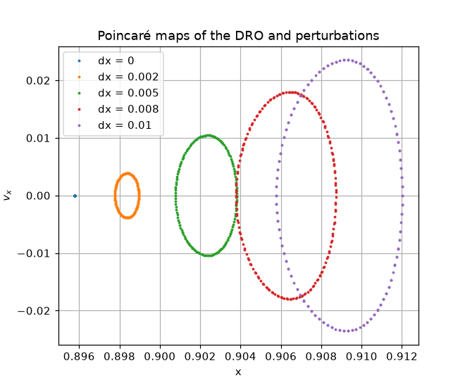
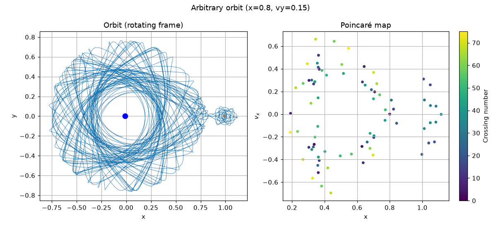

# Poincaré Maps in the Earth-Moon Three-Body Problem

Long integrations in the circular restricted three-body problem (CRTBP) quickly turn into
tangled curves that are hard to read. This notebook uses **Poincaré maps**, a "stroboscope"
that records the state $(x, v_x)$ only when the particle crosses $y = 0$ moving upward, to
reveal the hidden order and classify orbits as **periodic**, **quasi-periodic** or
**chaotic**.

## What's inside

`crtbp_poincare_maps.ipynb` integrates five planar orbits in the Earth-Moon rotating frame,
two of them with real initial conditions from NASA/JPL's
[Three-Body Periodic Orbits](https://ssd.jpl.nasa.gov/tools/periodic_orbits.html) database:

| Orbit | Poincaré map | Type |
|---|---|---|
| Distant Retrograde Orbit (JPL) | Single fixed point (spread ~1e-11) | Periodic, stable |
| DRO shifted by 0.002-0.01 in x | Closed curves | Quasi-periodic |
| L1 Lyapunov orbit (JPL) | Fixed point for ~3 periods, then escapes | Periodic, unstable |
| Perturbed Lyapunov orbit | Scattered points, then escape | Chaotic |
| Arbitrary initial conditions | Scattered cloud, bounded | Chaotic |

<p align="center"></p>

Perturbing the stable DRO only produces closed curves: nearby orbits stay ordered.

<p align="center"></p>

An arbitrary orbit that wanders between the Earth and the Moon: tangled in $(x, y)$,
and a scattered cloud on the map, the signature of chaos.

## Highlights

- **Event detection** with `solve_ivp` to catch exact axis crossings (`direction=+1` keeps
  only upward crossings).
- **Stability matters, not just periodicity:** the JPL Lyapunov orbit (stability index 54)
  repeats exactly for 3 periods, then the $10^{-12}$ integration error is amplified ~100x
  per revolution until the particle escapes. The DRO (index 1) stays put for 147
  revolutions.
- **Validation:** the Jacobi constant reproduces JPL's value for the DRO (3.0173) and is
  conserved to ~1e-10 along the chaotic orbit, so the scatter is real dynamics, not
  numerical noise.
- **Integrator choice:** `DOP853` with `rtol=atol=1e-12` ran ~60x faster than `Radau` for
  the same accuracy target.

## Tech stack

Python · `scipy` (`solve_ivp`, event detection) · `numpy` · `matplotlib`

## Running it

```bash
pip install -r requirements.txt
jupyter notebook crtbp_poincare_maps.ipynb
```
